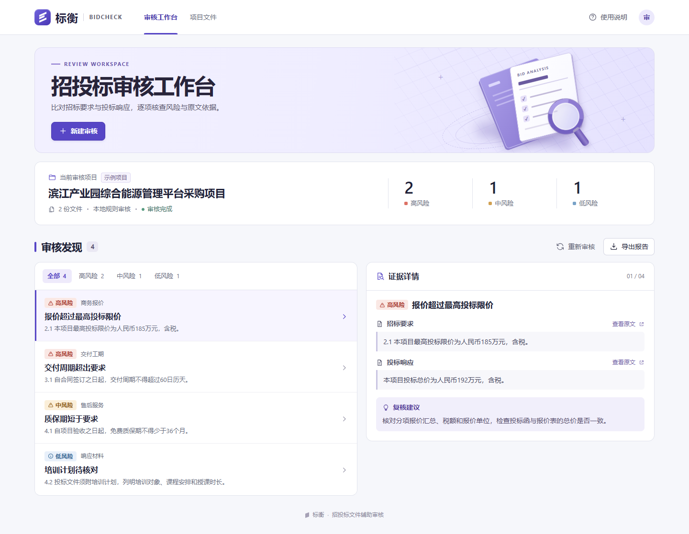

# 标衡 · 招投标文件审核 Demo

把一份招标文件和一份投标文件放在一起，核查报价、交付期限、质保期、投标有效期和部分响应材料。每条发现展示风险等级、招标要求、投标响应及复核建议，便于回到文件确认。



## 启动工作台

安装 Node.js 22 或更新版本，在终端执行以下命令。

```bash
git clone https://github.com/NicholasZhao-zhenglin/biao.git
cd biao
node server.mjs
```

在浏览器打开 [本地工作台](http://127.0.0.1:4173)。浏览器端解析库已随仓库提供，无须安装 npm 依赖。

## 用示例走一遍

首页展示虚构的“滨江产业园综合能源管理平台采购项目”，可以直接选择一条发现，核对两侧原文。例如，招标文件将投标限价定为 **185 万元**，投标文件报出 **192 万元**。交付周期也从要求的 **60 日历天**延长到了 **75 日历天**。

1. 点击“重新审核”，在投标正文中将 192 万元改成 180 万元，再运行本地审核。报价超限提示会消失。
2. 点击“新建审核”，分别上传招标、投标文件或粘贴正文。支持 TXT、DOCX、含文本层的 PDF。导入上限为每份 10 MB、120,000 个字符，PDF 最多 200 页。扫描版 PDF 需要先做 OCR。
3. 按风险等级筛选发现，逐项核对引文。点击“导出报告”可下载 Markdown 报告。

## 连接 AI 模型

默认使用浏览器内的本地规则。需要语义审核时，将 `.env.example` 复制为同目录下的 `.env`，填写服务地址、模型标识和密钥后重启服务。

```dotenv
AI_BASE_URL=https://api.openai.com/v1
AI_MODEL=填写账号已开通的模型标识
AI_API_KEY=填写服务商密钥
```

服务商需兼容 Chat Completions 接口及 JSON 对象输出。配置完成后，在审核表单中选择 AI 模式并提交。此操作会通过本机服务将两份正文发给配置的模型服务商，每份限 60,000 个字符。服务端会逐字校验模型引文，无法在对应文档中定位引文时会提示重新审核。

本地规则模式在当前浏览器内处理两份文件。工作台不保存项目历史，刷新前可导出报告。模型密钥只在服务端读取，`.env` 已加入 Git 忽略列表。

## 审核范围

本地规则覆盖若干常见中文条款表述和单位。未识别的条款、扫描图片、表格版式及附件可能影响结果。未匹配到材料时，工作台提示复核附件。发现数量为零表示当前方法未检出问题，最终判断需结合完整原件、澄清文件及项目具体要求。

## 运行测试

```bash
node --test
```

模型接口测试使用受控响应验证文档传递、引文校验和异常处理。使用真实模型需要自己的服务商配置。
